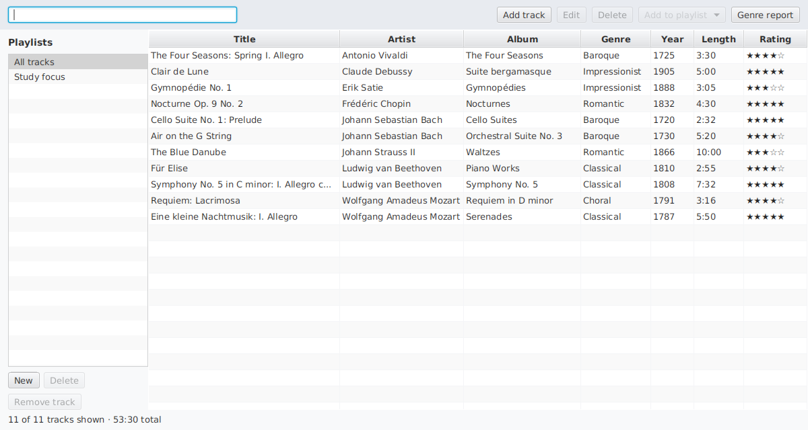

# Music Library (JavaFX + SQLite)

[](https://github.com/Siya166/music-library-javafx/actions/workflows/ci.yml)

A desktop app for managing a music collection: add, edit and delete tracks, search instantly across every field, sort any column, build playlists and see a report by genre. Data is stored in a relational SQLite database through JDBC.



## Features

- **Searchable table:** type "beethoven sym" and only matching tracks remain; every word must match title, artist, album, genre or year.
- **Sortable columns:** length and rating sort by their real values, not their display text.
- **Modal add/edit window:** all input problems are listed together, and the window will not close until the input is valid.
- **Playlists:** create and delete playlists, add tracks from a menu, remove them, and keep their order.
- **Genre report:** track count, total time and average rating per genre, computed with SQL `GROUP BY`.
- **Runs with no setup:** SQLite is embedded, and the first run adds sample public-domain classical tracks.

## Quick start

You need Java 21 and Maven. JavaFX is downloaded by Maven.

```bash
git clone https://github.com/Siya166/music-library-javafx.git
cd music-library-javafx
mvn javafx:run        # start the app
mvn verify            # run the 29 tests
```

The database is saved at `~/.music-library/library.db`. To use another file: `mvn javafx:run -Dmusiclibrary.db=/path/to/file.db` (or pass the same `-D` option to `java`).

## Architecture

```
ui/          JavaFX windows       MainView, TrackDialog, GenreReportDialog
   |  calls
service/     business rules       LibraryService (validation, search, reports), Durations
   |  depends on interfaces only
repository/  TrackRepository, PlaylistRepository        <- interfaces
   |  implemented by
repository/jdbc/  JdbcTrackRepository, JdbcPlaylistRepository, Database (SQLite)
```

`MusicLibraryApp` is the composition root: the only place that chooses the JDBC classes and passes them in through constructors.

### Design decisions

- **Dependency inversion (the D in SOLID).** `LibraryService` depends on repository interfaces, not on JDBC. That is why the service tests run against simple in-memory fakes, and why the storage could change (for example to PostgreSQL) without touching the UI or the rules.
- **Single responsibility.** The UI only displays and collects input, the service holds the rules, and repositories only talk to the database.
- **Normalised schema.** Artists, albums and tracks are separate tables joined by foreign keys, and playlists use a join table (`playlist_tracks`) for the many-to-many relationship. Albums and artists left with no tracks are removed automatically. See [`schema.sql`](src/main/resources/dev/tatenda/musiclibrary/schema.sql).
- **Transactions.** Each save runs in a transaction, so a failed save never leaves a half-created artist or album behind (there is a test for this).
- **Safe SQL.** Every query uses `PreparedStatement` parameters, never string concatenation, so input such as `'); DROP TABLE tracks;--` is stored as text (also tested).
- **Two layers of validation.** The service gives friendly messages; `CHECK` constraints in the schema are a second line of defence.

## Tests

29 JUnit 5 tests, run on every push by GitHub Actions:

| Test class | What it covers |
| --- | --- |
| `JdbcRepositoryTest` | Real SQL against an in-memory SQLite database: inserts, updates, joins, `GROUP BY`, cascading deletes, constraints, rollback, SQL injection |
| `LibraryServiceTest` | Validation rules, search matching, playlist rules and seeding, using in-memory fakes |
| `DurationsTest` | Parsing and formatting `m:ss`, including bad input |

The JavaFX windows are checked by hand; the logic they call is covered by the tests above.

## What I would add next

- Import tracks from a folder of MP3 files by reading their tags.
- Drag and drop to reorder playlists.
- UI tests with TestFX.

## Licence

MIT
